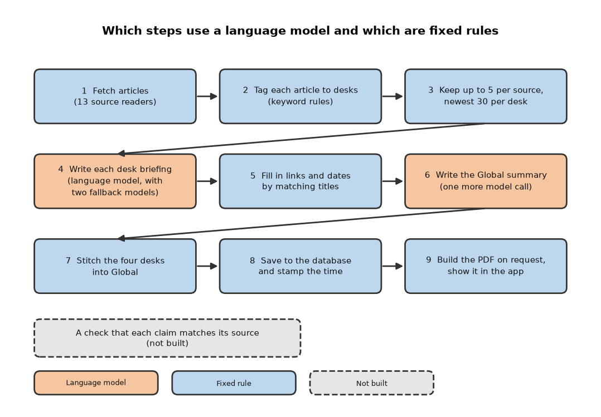
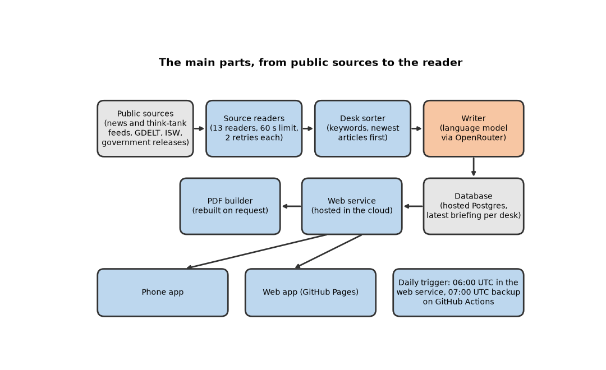
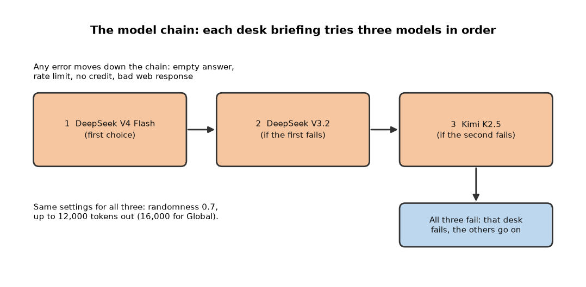

# SITREP

*A phone and web app that, each morning, has a language model write a short briefing for each of four world regions from that day's public defense and foreign-affairs articles, with links to the articles it drew on.*

Status: running daily as of the check on 27 October 2026, but one of the four regional briefings (the Indo-Pacific desk) failed that day, and I have not verified whether the optional admin token that the project's documents describe is switched on in the live service. No known real readers. Last code change in September 2026, last documentation change in October 2026. Code: https://github.com/PCSchmidt/SITREP (MIT licence, a permission for anyone to reuse the code). Live web app: https://pcschmidt.github.io/sitrep/.

I built SITREP, short for situation report (the military term for a short status update), to answer one question each morning: what changed in the world's trouble spots? It collects articles from public news feeds and think-tank sites, sorts them into four "desks" (a desk is one region's briefing: Middle East, Indo-Pacific, Europe/Africa and Western Hemisphere), and asks a language model to write each desk a briefing in BLUF (Bottom Line Up Front) layout: conclusion first, then evidence, then outlook. A language model is a program trained on huge amounts of text that writes new text one word-piece at a time. AI coding agents wrote almost all of the code, while I directed the scope, plan, architecture and preferences.

Here is what is fixed and what is learned. A calculator is deterministic: the same input always gives the same answer. A weather forecast is probabilistic: a best guess that can be wrong. SITREP is mostly calculator with one forecast in the middle. The fixed parts fetch the articles, sort them by keyword, choose which go in, stamp the date and save the result. The probabilistic part is the model that writes the briefing; it runs with its randomness setting (called temperature) at 0.7, so the same articles can give a different briefing each time. Nothing checks a claim against its source. The only audit is the reader clicking through the links.

For hiring purposes, the project shows that I can direct AI agents to build, deploy and keep running a scheduled model workflow. It does not show that the output is accurate, because I have never measured that.

The idea that makes it work is to write from articles fetched that morning rather than from the model's memory, and to attach each article's link. The main limit is that the link is the only audit. If you have ten minutes, read the chapters on what it does, the models, the results and real use.

In short, SITREP is a working, scheduled briefing service that I have not measured for accuracy and that no known reader uses.

## What problem this solves

News about conflicts and great-power competition is spread over dozens of outlets. Someone who follows the Middle East, the Pacific, Europe and Africa and Latin America must open many tabs and skim articles that repeat each other. Intelligence organisations solve this with analysts who write a short daily report; most people have no analyst. SITREP is that analyst built from software, with the difference that nobody reviews what it writes.

Existing options include news-summary apps, chatbots that summarise on request, and an AI-written newsletter called The LOWDOWN, which the project's front-page description file (its README) and my planning notes name as the inspiration. SITREP differs by following a fixed military format, covering four regions on a schedule, listing sources under each section and delivering a PDF (Portable Document Format, a fixed-layout document). It is worse in obvious ways: free public sources only, no breaking-news speed, and no way to tell a reader how reliable a claim is.

Defense-sector topics interest me. The project began on 21 May 2026 as a planning chat about recreating that newsletter. The first plan proposed a Claude model for the writing and a stealth browser (software that hides that a robot is visiting a site) for hard-to-reach sites; the finished system uses cheaper models reached through a different service, and plain feed readers. The planning notes' goal is a daily four-region briefing with sources, at a fraction of a cent each, live in the Google Play and Apple app stores. The first two can be checked today; the store release is unfinished.

A chatbot would be quicker to set up and may be just as accurate. What SITREP adds is the fixed layout, the schedule and the phone app, not stronger assurance.

In short, SITREP tries to save a reader the time of reading many outlets, and it trades depth of checking for a steady daily product.

## What it does, step by step

Each morning SITREP fetches recent articles from thirteen sources, tags each with the regions it seems to be about, picks the newest for each desk, asks a language model to write the briefing, puts the web links and dates back into the source list, and saves the result so the app and the PDF can show it. A fifth "Global" briefing combines the four.

Here is a real example from the live site on 27 October 2026. The Middle East desk drew on 30 articles. Its first section, "Diplomatic & Regional Security Initiatives", cites an Al Jazeera article headed "Iran, Saudi, Turkiye and Pakistan agree to more talks amid Houthi attacks", published at 04:54 that day. The whole desk came to about 1,700 words with 27 listed sources, each with a web address.

Think of a newsroom with one rewrite desk: reporters (the readers) bring clippings, one writer (the model) writes, a clerk (the title-matching rule, explained below) checks that footnotes have addresses. There is no editor and no fact-checker.

The app has tabs for the four desks and Global; opening a briefing shows a summary, key developments, sections with sources and an outlook; and a button opens a PDF. It runs on a phone and in a browser. Everything is automatic; no person approves a briefing. It could not be used as it is in a government or regulated setting: it sends article text to outside paid services, publishes without review, and its start-a-run and debug routes (web addresses a program answers) are guarded by an optional password that I have not verified is switched on in the live service.

In short, public articles go in, a four-desk briefing comes out, and a reader decides how much to trust it.

## The parts, the data and the rules

The system has a few parts, each with one job. Thirteen source readers fetch articles: feeds (web pages that list new articles for programs to read, also called RSS) from defense trade outlets and think tanks, search feeds standing in for sites that block direct access, GDELT (the Global Database of Events, Language and Tone, a service that monitors news worldwide), the site of the ISW (Institute for the Study of War, a think tank), and US and UK government releases. A runner starts all readers at once, gives each 60 seconds per attempt (GDELT has its own longer limit) and two retries, and moves on if one fails. A sorter assigns articles to desks, a writer (the language-model call) drafts the briefings, a database stores them, and a web service answers the apps and builds PDFs.

Hosted services carry these parts, and only their roles matter. One cloud host runs the web service, and a hosted database stores the briefings. OpenRouter is a service that sells access to many language models under one account. A toolkit builds the phone app and the web app from one codebase, and GitHub Pages hosts the web app. The glossary names the vendors.

The daily run starts in two ways. A timer inside the web service fires at 06:00 UTC (Coordinated Universal Time, the world reference clock). A GitHub Actions workflow (GitHub's built-in scheduler) checks at 07:00 UTC whether today's briefing exists and starts the run only if it does not. That second trigger was added after the in-service timer missed a run on 4 June 2026, according to a comment in the workflow. A full run takes about 20 minutes.

Each article is cut to 2,000 characters (2,500 for the Global call) before it goes into the prompt, the written instructions and material sent to the model. Only the newest briefing for each desk is kept, so the database holds no history of past days.

Several rules are enforced in code. The desk name is forced to the one I asked for, because the model sometimes shortened "Europe/Africa" to "Europe". The generation time is stamped by the server, because the model once invented it. Writing to the database needs a service key, a powerful database password that ordinary public keys lack. The run-starting and debug routes accept an admin token (a shared password sent with the request) only when one is set. The guard is opt-in, and I have not verified that it is on in the live service.

A crash mid-run loses that run, while stored briefings survive. A failed source counts as zero articles, and a failed desk does not stop the others. The weakest link is the single model account: if its key stops working or the credit runs out, every desk fails together.

In short, simple readers feed one model call per desk and one database, with almost no checking after the model.

## The methods and the arithmetic

Little mathematics is involved. The few methods are rules of thumb written as code, each checkable by hand.

**Sorting articles into desks.** The program lowercases each title and text and looks for keywords. Words like "iran", "israel" or "gaza" put it on the Middle East desk; "china", "taiwan" or "japan" on Indo-Pacific; "ukraine", "russia" or "nato" on Europe/Africa; and a longer list including "cartel", "border" and "oas" (the Organization of American States) on Western Hemisphere. An article can land on several desks, and one with no match is tagged "Global". The match looks for the keyword anywhere inside a word, which causes mistakes. Using the real rules on a headline alone, "Coast Guard seizes cutter" contains "oas" inside "coast" and lands on Western Hemisphere, and "Miranda rights case" contains "iran" and lands on Middle East. The reverse also happens: "Ukrainian drones hit refinery" matches nothing, because the keyword is "ukraine", so it is tagged Global. Nobody has measured how often a wrongly sorted article reaches a briefing.

**Choosing which articles go in.** For one desk, the program takes the newest five articles from each source, then the newest 30 of those, so one prolific source cannot fill the desk.

**Putting back links.** The model returns source entries with a name and a title and often leaves out the web address. The program lowercases each title, collapses spaces and looks for an identical title among the articles it sent. If found, it copies in the address, date and source name. A citation whose title differs slightly, or is invented, gets no link and is kept anyway. The prompt also lets the model write addresses itself, so an address may come from the model and nothing checks it. On the four live desks on 27 October, 77 of 98 listed sources carried an address; the stored briefing does not say whether a missing one was a paraphrased title or an invented one.

**Building the Global briefing.** One extra model call writes a short cross-region summary. The program then copies every section from the four desk briefings, adds the desk name to each title and saves the result; Global's key-developments list and outlook stay empty. On 27 October it had 14 sections and 90 articles, where the project's documents describe 17 sections and 120 articles. That fits one desk having failed that morning (see the results chapter).

In short, a keyword sorter, a recency cap, a title match and a stitching step, each simple enough to check by hand, with the keyword sorter the least reliable.

## The models and what they do

SITREP uses language models for one job, writing the briefings. None is trained or adjusted by the project; all are rented through OpenRouter.

DeepSeek V4 Flash is the first choice. DeepSeek is an AI company, and this is its low-priced model. For each desk it receives the prompt and up to 30 articles and returns one block of JSON (JavaScript Object Notation, a strict text format programs can read): a summary, four to six sections each with sources, key developments and an outlook. The project's decision record says it was chosen because it cost about 99 percent less than the model the project started with, GPT-4o Mini (a small OpenAI model), and because trial runs gave complete briefings with citations. It says quality was "maintained", but the repository holds no quality scores; the comparison scripts only check that each model answers and count tokens (a token is a small chunk of text, roughly a short word).

DeepSeek V3.2 and Kimi K2.5 (Kimi is a model family from the company Moonshot AI) are the fallbacks, in that order, called only when the earlier model returns an error, an empty answer, a rate limit or an out-of-credit message. Each briefing records which model wrote it. On 27 October three desks were written by V4 Flash, while the Indo-Pacific briefing still on the site, from the previous morning, was written by V3.2, so the fallback has run in practice. Cost rises down the chain, from a stated tenth of a cent to just under a cent per briefing.

The prompt for a desk asks for a BLUF of five to seven sentences, four to six sections of 300 to 500 words with five to eight cited sources each, seven to ten key developments and an outlook. It includes one full example summary full of specific figures and asks the model to exceed it. Asking for exact figures may push a model toward specifics the articles do not give; that is my reading, not something measured.

The temperature is 0.7 for every call, so wording and emphasis change from run to run. The output limit is 12,000 tokens per desk and 16,000 for Global. Earlier runs forced fixes for truncated answers, empty answers and answers wrapped in code fences (markers around code). If an answer is not valid JSON, that desk fails; there is no repair request. Each of those faults was fixed in code after it happened; whether the models state wrong facts is unknown, because nothing measures it.

The documents estimate about a tenth of a cent per desk briefing and about 15 cents a month for a daily run, plus hosting. No bill was checked and the hosting cost is not documented. A plain list of headlines with links would cost nothing in model fees; what the model adds is synthesis across articles, and whether it adds accuracy is unknown.

In short, one rented model writes every briefing, two fallbacks stand behind it, and no test or checker shows how often it is right.

## Testing, edge cases and safeguards

An edge case is an unusual situation: an empty answer, a duplicate story, a service that is down. Probes with a stand-in for the model, run in a scratch copy of the project, covered several. With no articles for a desk, a placeholder briefing saying there is no recent intelligence comes back. If the model wraps its JSON in code fences, they are stripped and the JSON parsed; if it gives the wrong desk name, the name is overwritten. These work. Two do not work well. If the model returns text that is not JSON, the desk fails with an error, and the others continue, but there is no retry. If it cites an article that does not exist, the entry is kept without a link and nothing flags it. By reading the code, a source that is down returns nothing and the run continues, and a host restart mid-run loses that run while stored briefings survive. The documents say a second run started during a run is refused, but the repository has no such code.

The automatic tests are 11 checks of two small things: that the admin-token guard allows or refuses the right requests, and that the database client prefers the powerful key over the public one. They run offline and, in a scratch copy with Python 3.12 and the pinned library versions, all 11 passed in about eight seconds. No test covers the readers, the sorter, the model client, the prompt, the title matching, the PDF builder or the phone app. The only automatic workflow on GitHub is the daily trigger, not a test gate, and any push to the main branch redeploys (publishes anew) the service, so a bad change can reach production unchecked.

Safeguards in the program are the time limit and retries on every reader, the model fallback chain, the desk-name and timestamp fixes, the opt-in admin token, the service-key requirement for writing, and a phone app that keeps showing the last good briefing when the server returns nothing. The briefings carry a note that the sources are real and the wording is model-written. That note says more than the code checks, since nothing verifies that a cited article exists or supports the sentence. There is also prompt injection: article text flows straight into the prompt, so a malicious article could instruct the model to say something else. The README names that risk as not mitigated.

Production failures are the strongest testing evidence here. A run missed on 4 June led to the backup trigger; the invented generation time, found on 11 June, led to server stamping; empty answers crashed the Global step on 31 May. On 12 September the briefings began vanishing after each redeploy, because writes were failing quietly with the wrong database key while the host's disk, wiped on every redeploy, held the briefings. The fixes were the service-key rule, a pinned version of the database library, and on-demand PDFs.

In short, a few plain pieces are tested, and the model, the sorting and the whole pipeline are checked only by running in production.

## Does it work? The results

The project reports no measurement of accuracy, so there are two kinds of evidence. The first is that it runs. The README records a run on 12 September 2026: four desks of 30 articles each plus Global, finished in under 20 minutes, with all five briefings and PDFs returning. A check of the live service on 27 October found the health address answering "ok" for version 0.21.11, the web app loading, and the timer reported as running with the next run at 06:00 UTC on 28 October. Three desks and the Global briefing had been generated between 06:15 and 06:29 UTC that morning, which matches the in-service timer rather than the backup. The Indo-Pacific desk still showed the previous morning's briefing, its newest article dated 26 October. It probably failed on the day, since Global shows 90 articles instead of 120, but the reason is not visible.

The second kind is the shape of the output. The four desk briefings had 4 or 5 sections of about 1,100 to 1,700 words, ten key developments, and none was cut off. Of the 98 sources, 77 carried a web address and 21 did not.

What is missing is any measurement against people or a baseline. Nobody has scored a briefing for accuracy, invented details or usefulness, so it is unknown whether a plain list of headlines would serve a reader as well.

Some of the documentation runs ahead of the code, meaning it describes things the code does not do. For example, the README says every claim carries the link it came from, while 21 of 98 sources lacked an address. It says one model call per desk, but there is a fifth call for the Global summary. It says Global has a full set of sections, yet the live Global briefing has no key developments or outlook, and it says a second run is refused, though the repository has no code for that. The cost estimate is the project's own.

In short, the project shows it runs and produces complete briefings, but whether they are accurate has never been measured.

## Could it be put into real use?

It is deployed already: the web service runs on a cloud host, the data sits in a hosted database, the web app is on GitHub Pages, and a daily schedule has been in place since 31 May 2026. The live check shows the run producing briefings on 27 October, with one desk failing. Whether it ran every day from June to October is not shown, because the database keeps only the latest briefing and the logs are not in the repository. Who uses it is not known. The documents list 15 email addresses for an Android closed test (a required trial with a minimum number of testers before Google lets an app go public; for affected personal accounts, 12 testers for 14 days), but the opted-in count is marked as not verified. No usage numbers appear anywhere, even though the phone app has crash reporting (Sentry) and usage counting (Mixpanel) wired in. I would call it deployed and reachable, with no known real readers.

Against a production checklist, the picture is mixed. Others can partly run it from a clean start: a quick-start and deployment guide exist, but it needs several outside keys and a hosted database. Automatic checks do not block a bad change, since the 11 tests are not run on push. Quality is not measured against any baseline. Failure handling is partial: time limits, retries and model fallbacks, but no cost cap, queue or resume. No person can review or stop the AI's work. Prompts and models are versioned in git and the model used is recorded per briefing. Logs hold a run summary and token counts but no history of runs and no alerts beyond a failing workflow. Secrets are kept in the host's settings, but the project's documents describe an optional admin token for the run-starting and debug routes, and I have not verified whether it is switched on in the live service.

It mirrors real practice in a backup trigger added after a missed run, a written incident note, a pinned library version with its reason and a decision log of 15 dated entries. A real deployment would still need a quality check on the briefings, tests that gate each release, an alert when a desk fails, a rollback plan (a way to return to the last good version), a spending cap, the admin token confirmed on and a review of the scraping rules. As a showcase it is a possible candidate: a real deployed workflow with a fallback chain and a history of fixes, cheap to run, but with no accuracy measurement and no users.

In short, SITREP is deployed and recoverable, but not monitored for quality and not shown to have real readers.

## Strengths, shortcomings and the work still to do

The strengths are practical: fresh briefings on the check day and a run that carries on when a source or model fails. The deliberate limits are no accounts, no personalisation and free sources only. Three shortcomings matter most. First, nothing checks the briefings, so the only audit is the reader. A first step would be to sample 50 briefing sentences, label them by hand and report how many the cited article supports. A heavier option is a second model that checks each claim, as my other projects do, at more cost and complexity. Second, the admin token is opt-in, and I have not verified that it is on in the live service; before real use it should be confirmed on, which is a small change. Third, changes are not tested before they ship. Running the existing 11 tests on each push is a few lines; tests for the sorter and the title matching are a larger job.

Promised versus built: the desks, Global, PDFs, schedule, apps and Android build are done; the store release is in progress; accounts, push notifications and search are planned, not started. The scraping practices (no check of each site's robots file, the rules sites publish for automated visitors; a browser-like identity; and search feeds standing in for blocked sites) are disclosed in the README as something to fix before adding sources. The next milestone I would pick is to confirm the admin token is on, run the tests on each push and hand-check 50 sentences. SITREP is worth finishing, because it is already deployed and cheap, but finishing means measuring it, not adding features.

To run it yourself you need Python 3.11 or newer, an OpenRouter key and a hosted database project with a service key; the phone app needs Node and Expo tools. It cannot run offline.

In short, the pipeline runs and recovers from failures, but the content is unchecked and the admin token's live state is unverified, so the best next step is to measure the briefings.

## How it was built, and who did what

AI coding agents wrote almost all of the code, and I directed the scope, plan, architecture and preferences. I did not write the code by hand, and I do not claim to have. All 123 commits carry my name.

The project followed my own template for AI-built software, which its files call Blueprint v11: numbered stages that need a document and a sign-off, a decision log and memory files for the agents. The log records dated decisions with alternatives, with me as owner and approver of every entry, since it is a solo project. The history shows agents fixing their own work, such as the invented-timestamp fix and the 12 September recovery. The agents' work was checked mainly by running the app on a phone and in a browser.

In short, I steered and the agents typed, and the history shows a build shaped by production failures.

## For recruiters and interviewers

In thirty seconds: I directed AI coding agents to build and deploy a daily briefing service that reads public news, has a language model write a briefing for four world regions, and serves them in a phone and web app with sources attached. It runs on a schedule with a backup trigger and a chain of three models. In two minutes, add the storage outage and the missed run it came through, and that it has no accuracy measurement, no known readers and only a handful of tests.

It demonstrates deploying a scheduled model workflow, recovering from failures, choosing cheap models with fallbacks, shipping a phone app toward a store, and directing AI agents. Incidents and fixes are written up in the repository; the store release is unfinished. It does not demonstrate quality evaluation, human review of AI output, teamwork, scale or paying customers. Evaluation is the main gap.

The closest role family is the applied language-model workflow engineer, a partial fit. The weakest fit is the engineer who trains and monitors models, since nothing is trained and little is monitored. This is a scheduled pipeline with one model call, not a set of autonomous agents.

Likely questions, answered briefly. The hardest problems the history shows were about keeping it running: a missed run, briefings lost on redeploy, and a model that invented a timestamp, each fixed after it happened. How do I know it works? It runs daily, but the only audit is the source links. Isn't it a wrapper around a model service? The writing is; the readers, sorting, fallbacks, storage and apps are the engineering. If agents wrote the code, what did I do? I set scope and architecture and judged the results. Malicious input is a known unmitigated risk.

What not to exaggerate: the accuracy of the briefings, any claim about users, the store status, and the sources being "real" as a verified property. I did not write the code by hand.

In short, SITREP shows deployment and recovery skills with gaps in measurement and users.

## Glossary

- **API route:** a web address that a program answers, such as the one that starts a run.
- **Admin token:** a shared password sent with a request; optional here, and I have not verified that it is on in the live service.
- **BLUF (Bottom Line Up Front):** a briefing layout with the conclusion first.
- **Commit:** a saved change to the code, with a note.
- **Deploy (and redeploy):** put a new version of a program live.
- **Desk:** one region's briefing.
- **Docker:** a way of bundling a program with everything it needs to run.
- **Expo and React Native:** toolkits that build a phone app and a web app from one codebase.
- **Fallback:** a backup model tried when the first one fails.
- **FastAPI:** a Python toolkit for building web services.
- **Feed (RSS, Really Simple Syndication):** a page that lists new articles for programs to read.
- **GDELT (Global Database of Events, Language and Tone):** a service that monitors world news.
- **ISW (Institute for the Study of War):** a think tank whose site is one source.
- **JSON (JavaScript Object Notation):** a strict text format that programs can read.
- **Language model:** a program trained on huge amounts of text that writes new text.
- **OpenRouter:** a service selling access to many language models under one account.
- **Postgres:** a widely used database system.
- **Prompt:** the written instructions and material sent to a model.
- **Railway:** a service that runs a program in the cloud; it hosts the web service.
- **README:** a project's front-page description file.
- **Repository (repo):** a project's folder of code and history.
- **Row-level security:** a database setting that blocks writes from ordinary public keys.
- **Scraping:** fetching web pages automatically.
- **Sentry and Mixpanel:** services that report crashes and count app usage.
- **Service key:** a powerful database password that can write data.
- **Supabase:** a hosted database service built on Postgres.
- **Temperature:** the randomness setting for a model, from 0 (steady) upward.
- **Token:** a small chunk of text, roughly a short word, in which models measure input and output.

## Where to look in the code

This note is for engineers; other readers can stop here. The repository has a Python web service folder (main file, scheduler, readers, writing code, database client, PDF builder, two test files), a phone and web app folder, the backup-trigger workflow and many documents. Start with the model client, the briefing writer and the main file. The 11 tests pass offline in a scratch copy on Python 3.12.
